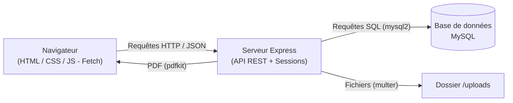
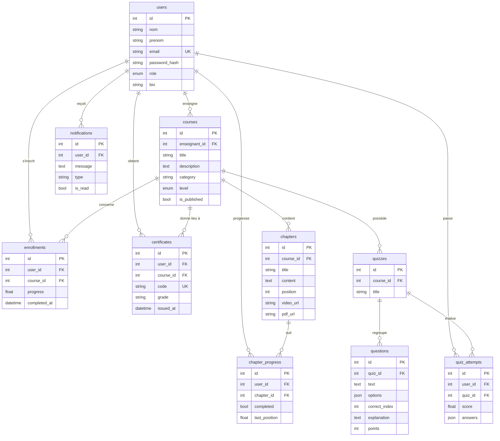

# RAPPORT DE PROJET

---

<div align="center">

## UNIVERSITÉ PRIVÉE HAY (UPH)
### Département Informatique

<br>

# PLATEFORME DE COURS EN LIGNE POUR ÉTUDIANTS
### (Thème 2)

<br>

**Projet réalisé dans le cadre de l'examen de fin de semestre**

| | |
|---|---|
| **Année académique** | 2025 – 2026 |
| **Niveau** | L1 – Semestre 2 – V2 |
| **Matière** | Programmation JavaScript |
| **Enseignant** | Mr RANDRIAMANANJARA Nico Olivier |
| **Titre du projet** | Plateforme de cours en ligne pour étudiants (Thème 2) |
| **Nom de l'application** | ChoukrApp Academie |
| **Auteur** | **[Ton Nom et Prénom]** |

</div>

---

## SOMMAIRE

1. [Introduction](#1-introduction)
2. [Fonctionnement général du projet](#2-fonctionnement-général-du-projet)
3. [Étapes de conception et de développement](#3-étapes-de-conception-et-de-développement)
   - 3.1 Architecture du système
   - 3.2 Schéma de la base de données
   - 3.3 Organisation du code
4. [Technologies et outils utilisés](#4-technologies-et-outils-utilisés)
5. [Liens de déploiement et dépôt GitHub](#5-liens-de-déploiement-et-dépôt-github)
6. [Captures d'écran](#6-captures-décran)
7. [Extraits significatifs du code source](#7-extraits-significatifs-du-code-source)
8. [Conclusion](#8-conclusion)

---

## 1. Introduction

### 1.1 Contexte
Avec la démocratisation d'Internet et des outils numériques, l'enseignement à distance (*e-learning*) est devenu une pratique courante. Les plateformes de cours en ligne permettent aux étudiants d'accéder à des contenus pédagogiques (vidéos, documents, exercices) à tout moment et de suivre leur propre rythme d'apprentissage.

C'est dans ce contexte que s'inscrit le présent projet intitulé **« Plateforme de cours en ligne pour étudiants »**, réalisé dans le cadre de la matière **Programmation JavaScript** (L1 – S2 – V2) à l'Université Privée Hay (UPH).

### 1.2 Problématique
Comment concevoir et développer une application web complète, reposant sur **JavaScript** côté client **et** côté serveur, permettant :
- la gestion des utilisateurs (étudiants et enseignants) ;
- la diffusion de cours structurés en chapitres (vidéos et supports PDF) ;
- le suivi de la progression ;
- l'évaluation automatique par des quiz ;
- et la génération automatique de certificats de réussite ?

### 1.3 Objectifs
- **Objectif général :** concevoir une plateforme e-learning fonctionnelle et ergonomique.
- **Objectifs spécifiques :**
  1. Mettre en place une **API REST** avec **Node.js + Express**.
  2. Concevoir une **base de données relationnelle** (MySQL).
  3. Développer un **frontend dynamique** en HTML5/CSS3/**JavaScript (Fetch API)**.
  4. Gérer l'**authentification** et les **rôles** (étudiant / enseignant / administrateur).
  5. Implémenter la **correction automatique** des quiz et le **calcul des notes**.
  6. Générer des **certificats PDF** et un **système de notifications**.

### 1.4 Plan du rapport
Après cette introduction, nous présenterons le **fonctionnement général** de l'application, puis les **étapes de conception et de développement** (architecture et schéma de la base), les **technologies utilisées**, les **liens de déploiement**, des **captures d'écran** et des **extraits de code** commentés. Enfin, nous conclurons par une synthèse, les difficultés rencontrées et les perspectives.

---

## 2. Fonctionnement général du projet

L'application **ChoukrApp Academie** repose sur une architecture **client – serveur** à trois couches :

1. **Le navigateur (client)** affiche les pages HTML/CSS/JS. Le JavaScript réalise des requêtes **asynchrones (Fetch API)** vers l'API sans recharger la page.
2. **Le serveur (Node.js + Express)** expose une **API REST** : il traite les requêtes, applique les règles métier et interroge la base.
3. **La base de données MySQL** stocke de façon persistante utilisateurs, cours, chapitres, inscriptions, quiz, notes, certificats et notifications.

### Parcours utilisateur type (étudiant)
1. L'étudiant **s'inscrit** puis **se connecte** (mot de passe chiffré avec bcrypt).
2. Il parcourt le **catalogue**, filtre et recherche des cours.
3. Il **s'inscrit à un cours** : il accède aux chapitres (lecteur vidéo + support PDF).
4. Il regarde les vidéos, télécharge les supports et **marque chaque chapitre comme terminé** → la **progression** se met à jour automatiquement.
5. Il passe les **quiz** : les réponses sont envoyées au serveur qui **corrige automatiquement** et **enregistre la note**.
6. Lorsque **100 % des chapitres** sont terminés **et** que la **moyenne des quiz ≥ 60/100**, un **certificat PDF** est **généré automatiquement**.
7. Il retrouve dans son **tableau de bord** ses cours, ses notes, ses certificats et ses **notifications**.

### Parcours enseignant
- Création/édition/suppression de **cours**.
- Ajout de **chapitres** avec **téléversement** de vidéos et de supports PDF.
- Création de **quiz** et de **questions** (QCM).

---

## 3. Étapes de conception et de développement

### 3.1 Architecture du système



**Séparation des responsabilités (design pattern MVC simplifié) :**

| Couche | Rôle | Dossiers |
|--------|------|----------|
| **Routes** | Définissent les URL de l'API | `routes/` |
| **Contrôleurs** | Traitent la requête, appliquent les règles métier | `controllers/` |
| **Modèles (DAO)** | Accèdent à la base de données | `models/` |
| **Services** | Logique transversale (PDF, notifications) | `services/` |
| **Middlewares** | Authentification, rôles, uploads | `middlewares/` |

### 3.2 Schéma de la base de données

La base `choukrapp_db` comporte **9 tables** reliées par des clés étrangères.



**Description des tables :**

| Table | Description |
|-------|-------------|
| `users` | Comptes (étudiant / enseignant / admin), mot de passe hashé. |
| `courses` | Cours créés par un enseignant (titre, catégorie, niveau, publication). |
| `chapters` | Chapitres d'un cours avec URL vidéo et PDF. |
| `enrollments` | Inscription d'un étudiant à un cours + pourcentage de progression. |
| `chapter_progress` | État (terminé ou non) et dernière position de lecture par chapitre. |
| `quizzes` | Quiz rattachés à un cours. |
| `questions` | Questions (QCM) : options JSON, index de la bonne réponse, explication. |
| `quiz_attempts` | Tentatives d'un étudiant avec la note calculée automatiquement. |
| `certificates` | Certificats délivrés (code unique, mention). |
| `notifications` | Messages adressés à un utilisateur. |

### 3.3 Organisation du code

Le projet suit une organisation claire et modulaire (voir `README.md`). Les dossiers principaux sont : `config/`, `middlewares/`, `models/`, `controllers/`, `routes/`, `services/`, `database/`, `scripts/` et `public/`.

---

## 4. Technologies et outils utilisés

| Domaine | Technologie | Justification |
|---------|-------------|---------------|
| Serveur | **Node.js** | Exécuter du JavaScript côté serveur. |
| Framework web | **Express 5** | Créer rapidement une API REST. |
| Base de données | **MySQL** + **mysql2** | Stockage relationnel robuste, requêtes paramétrées. |
| Sécurité | **bcrypt** | Hachage des mots de passe. |
| Sessions | **express-session** | Authentification par session. |
| Uploads | **multer** | Téléversement des PDF et vidéos. |
| PDF | **pdfkit** | Génération des certificats de réussite. |
| Frontend | **HTML5 / CSS3 / JavaScript Vanilla** | Interface dynamique via **Fetch API**. |
| Outils | npm, nodemon, VS Code, Git/GitHub, WAMP | Développement, tests, versionnement, serveur MySQL local. |

---

## 5. Liens de déploiement et dépôt GitHub

- 🔗 **Dépôt GitHub :** `https://github.com/VOTRE-COMPTE/choukrapp-academie`
- 🌐 **Application déployée :** `https://VOTRE-URL-DE-DEPLOIEMENT`
- 📄 **Compte Supabase (facultatif, base PostgreSQL) :** `https://supabase.com/dashboard`

**Commandes de publication :**

```bash
git init
git add .
git commit -m "ChoukrApp Academie - Plateforme de cours en ligne (Thème 2)"
git branch -M main
git remote add origin https://github.com/VOTRE-COMPTE/choukrapp-academie.git
git push -u origin main
```

---

## 6. Captures d'écran

> 📷 Remplacer chaque bloc ci-dessous par une capture d'écran de l'application.

### 6.1 Page d'accueil
```
[ CAPTURE D'ÉCRAN — Accueil avec le bandeau et la liste des cours ]
```

### 6.2 Connexion / Inscription
```
[ CAPTURE D'ÉCRAN — Formulaire de connexion ]
```

### 6.3 Catalogue (recherche + filtres)
```
[ CAPTURE D'ÉCRAN — Catalogue avec filtres par catégorie et niveau ]
```

### 6.4 Espace de cours (lecteur vidéo + support PDF + progression)
```
[ CAPTURE D'ÉCRAN — Espace de cours ]
```

### 6.5 Quiz interactif + résultat
```
[ CAPTURE D'ÉCRAN — Quiz et correction immédiate ]
```

### 6.6 Tableau de bord étudiant
```
[ CAPTURE D'ÉCRAN — Statistiques, notes et certificats ]
```

### 6.7 Espace enseignant
```
[ CAPTURE D'ÉCRAN — Gestion des cours et chapitres ]
```

### 6.8 Certificat PDF généré
```
[ CAPTURE D'ÉCRAN — Certificat de réussite ]
```

### 6.9 Schéma de la base dans phpMyAdmin (WAMP)
```
[ CAPTURE D'ÉCRAN — phpMyAdmin, base choukrapp_db ]
```

---

## 7. Extraits significatifs du code source

### 7.1 Côté serveur — Middleware d'authentification (`middlewares/auth.middleware.js`)

```javascript
// Vérifie qu'une session valide existe avant d'autoriser une route protégée
exports.requireAuth = (req, res, next) => {
  if (req.session && req.session.userId) {
    return next(); // utilisateur connecté -> on continue
  }
  return res.status(401).json({ message: 'Authentification requise. Veuillez vous connecter.' });
};

// Restreint l'accès à certains rôles (ex : enseignant, admin)
exports.requireRole = (...roles) => (req, res, next) => {
  if (!req.session || !req.session.role) {
    return res.status(401).json({ message: 'Authentification requise.' });
  }
  if (!roles.includes(req.session.role)) {
    return res.status(403).json({ message: 'Accès refusé : rôle insuffisant.' });
  }
  return next();
};
```

### 7.2 Côté serveur — Authentification & hachage du mot de passe (`controllers/auth.controller.js`)

```javascript
exports.register = async (req, res) => {
  const { nom, prenom, email, password, role } = req.body || {};

  // Validation des données d'entrée
  if (!nom || !prenom || !email || !password)
    return res.status(400).json({ message: 'Nom, prénom, email et mot de passe sont obligatoires.' });

  // Vérifie l'unicité de l'email
  const existing = await userModel.findByEmail(email.toLowerCase().trim());
  if (existing.length > 0)
    return res.status(409).json({ message: 'Un compte existe déjà avec cet email.' });

  // Hachage du mot de passe (on ne stocke JAMAIS le mot de passe en clair)
  const hash = await bcrypt.hash(password, 10);
  const result = await userModel.create(nom.trim(), prenom.trim(), email, hash, role);
  // ...
};
```

### 7.3 Côté serveur — Correction automatique des quiz (`models/quiz.model.js`)

```javascript
exports.correctAndSave = async (userId, quizId, userAnswers) => {
  const questions = await exports.findQuestions(quizId);
  let points = 0, total = 0;

  const details = questions.map((q, i) => {
    const idx = userAnswers[i];
    const isCorrect = parseInt(idx, -1) === q.correct_index; // comparaison à la bonne réponse
    total += q.points;
    if (isCorrect) points += q.points;
    return { question_id: q.id, text: q.text, options: parseJson(q.options),
             user_answer: idx, correct_answer: q.correct_index, isCorrect,
             explanation: q.explanation };
  });

  const score = Math.round((points / Math.max(total, 1)) * 100); // note sur 100
  await exports.recordAttempt(userId, quizId, score, { answers: userAnswers });
  return { score, correct: points, total, details };
};
```

### 7.4 Côté serveur — Calcul de la progression (`models/enrollment.model.js`)

```javascript
exports.refreshProgress = async (userId, courseId) => {
  const [[stats]] = await pool.query(
    `SELECT
       (SELECT COUNT(*) FROM chapters WHERE course_id = ?) AS total,
       (SELECT COUNT(*) FROM chapter_progress cp
          JOIN chapters c ON c.id = cp.chapter_id
         WHERE cp.user_id = ? AND cp.completed = 1 AND c.course_id = ?) AS done`,
    [courseId, userId, courseId]
  );
  const progress = stats.total === 0 ? 0 : Math.round((stats.done / stats.total) * 100);
  await pool.query(
    `UPDATE enrollments SET progress = ?, completed_at = ${progress >= 100 ? 'NOW()' : 'NULL'}
      WHERE user_id = ? AND course_id = ?`,
    [progress, userId, courseId]
  );
  return progress;
};
```

### 7.5 Côté serveur — Génération du certificat PDF (`services/certificate.service.js`)

```javascript
exports.generatePdf = (user, course, certificate, stream) => {
  const doc = new PDFDocument({ layout: 'landscape', size: 'A4', margin: 0 });
  doc.pipe(stream); // écrit directement dans la réponse HTTP

  doc.rect(0, 0, doc.page.width, doc.page.height).fill('#f8fafc');
  doc.rect(20, 20, doc.page.width - 40, doc.page.height - 40)
     .lineWidth(4).strokeColor('#2563eb').stroke();

  doc.fillColor('#1e3a8a').fontSize(26)
     .text('CERTIFICAT DE RÉUSSITE', { align: 'center' });
  doc.fontSize(32).text(`${user.prenom} ${user.nom}`, { align: 'center' });
  doc.fontSize(20).text(course.title, { align: 'center' });
  // ... mention, code de vérification, date de délivrance
  doc.end();
};
```

### 7.6 Côté serveur — Point d'entrée du serveur (`server.js`)

```javascript
const express = require('express');
const session = require('express-session');
const config = require('./config/config');
const routes = require('./routes');

const app = express();
app.use(express.json());                 // lecture du JSON dans req.body
app.use(express.urlencoded({ extended: true }));

// Gestion des sessions utilisateur
app.use(session({
  name: 'choukrapp.sid',
  secret: config.sessionSecret,
  resave: false,
  saveUninitialized: false,
  cookie: { httpOnly: true, sameSite: 'lax', maxAge: config.sessionMaxAge }
}));

app.use(express.static(path.join(__dirname, 'public')));   // frontend
app.use('/uploads', express.static(path.join(__dirname, 'uploads'))); // médias
app.use('/api', routes);                                   // API REST

app.listen(config.port, () => console.log('ChoukrApp Academie démarré !'));
```

### 7.7 Côté client — Récupération dynamique des cours (`public/js/app.js` + `catalog.html`)

```javascript
// Noyau Fetch : toutes les requêtes passent par cette fonction sécurisée
const API = {
  async request(path, { method = 'GET', body = null } = {}) {
    const opts = { method, headers: {}, credentials: 'same-origin' };
    if (body) { opts.headers['Content-Type'] = 'application/json'; opts.body = JSON.stringify(body); }
    const res = await fetch('/api' + path, opts);
    const data = await res.json();
    if (!res.ok) throw new Error(data.message || 'Erreur');
    return data;
  },
  get: (p) => API.request(p),
  post: (p, b) => API.request(p, { method: 'POST', body: b })
};

// Catalogue : recherche + filtres SANS recharger la page
async function loadCourses() {
  const params = new URLSearchParams();
  const q = document.querySelector('#q').value.trim(); if (q) params.set('q', q);
  const cat = document.querySelector('#category').value; if (cat) params.set('category', cat);
  const { courses } = await API.get('/courses?' + params.toString());
  document.querySelector('#results').innerHTML = courses.map(card).join('');
}
```

### 7.8 Côté client — Soumission d'un quiz et affichage immédiat du résultat (`public/quiz.html`)

```javascript
async function submit() {
  // Récupère l'index coché pour chaque question
  const answers = Q.questions.map((_, i) => {
    const checked = document.querySelector(`input[name="q${i}"]:checked`);
    return checked ? Number(checked.value) : -1;
  });
  // Envoi au serveur -> correction automatique
  const result = await API.post('/quizzes/' + quizId + '/submit', { answers });
  showResults(result); // affiche score + correction détaillée + explications
}
```

---

## 8. Conclusion

### 8.1 Synthèse
Le projet **ChoukrApp Academie** est une plateforme de cours en ligne **complète et fonctionnelle**. Elle couvre l'ensemble du cahier des charges :
- ✅ **Authentification & comptes** (inscription, connexion, profils, rôles) ;
- ✅ **Gestion des cours & chapitres** (CRUD, supports PDF et vidéos) ;
- ✅ **Inscriptions & progression** (suivi dynamique par chapitre) ;
- ✅ **Quiz & évaluations** (correction automatique et notes) ;
- ✅ **Certificats & notifications** (PDF générés automatiquement) ;
- ✅ **Base de données relationnelle** (MySQL, 9 tables) ;
- ✅ **Interface frontend** (catalogue, lecteur, quiz, tableau de bord, espace enseignant).

Des **tests de bout en bout** ont validé les parcours essentiels (18/18 tests réussis) : connexion, catalogue, inscription à un cours, progression, quiz, tableau de bord, génération et téléchargement du certificat PDF, notifications.

### 8.2 Résultats obtenus
- Une API REST sécurisée (sessions + bcrypt + requêtes SQL paramétrées).
- Une interface réactive utilisant **Fetch** (mise à jour sans rechargement de page).
- Une correction automatique des quiz fiable et l'attribution automatique de certificats.

### 8.3 Difficultés rencontrées
- **Modélisation de la progression** : relier les chapitres terminés au pourcentage global du cours.
- **Gestion de l'authentification** et des sessions côté serveur.
- **Téléversement de fichiers** (PDF/vidéos) et génération de PDF avec pdfkit.
- **Configuration de MySQL** (démarrage du serveur WAMP, encodage UTF-8).

### 8.4 Limites
- Les sessions sont stockées **en mémoire** (à remplacer par un store persistant en production).
- Pas encore de **paiement en ligne** ni de **forum de discussion**.
- Le suivi vidéo est simplifié (position + validation manuelle).

### 8.5 Perspectives d'amélioration
- Intégrer un **store de sessions** (Redis/MySQL) et un déploiement cloud.
- Ajouter un **back-office administrateur** complet (gestion des utilisateurs).
- Mettre en place des **notifications en temps réel** (WebSocket).
- Proposer un **mode hors ligne** et une **application mobile**.
- Migrer éventuellement vers **PostgreSQL / Supabase** pour le déploiement.

---

<div align="center">

**Fin du rapport**

*© 2026 — ChoukrApp Academie — Université Privée Hay (UPH) — L1 S2 V2 — Programmation JavaScript*

</div>
